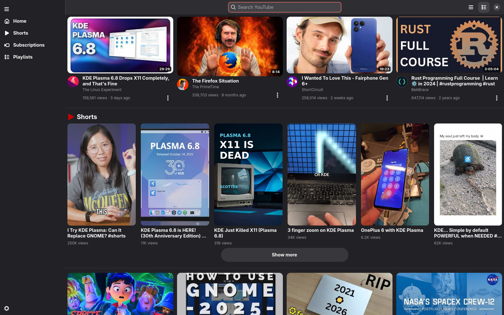
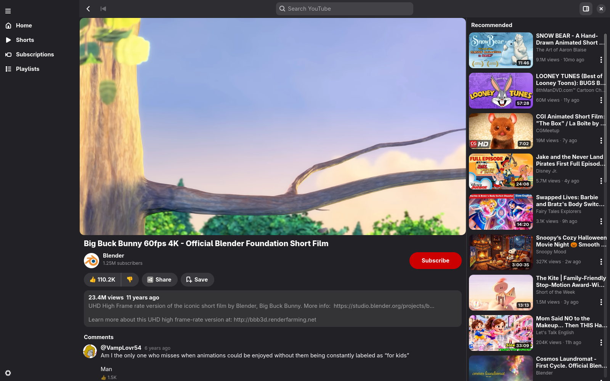
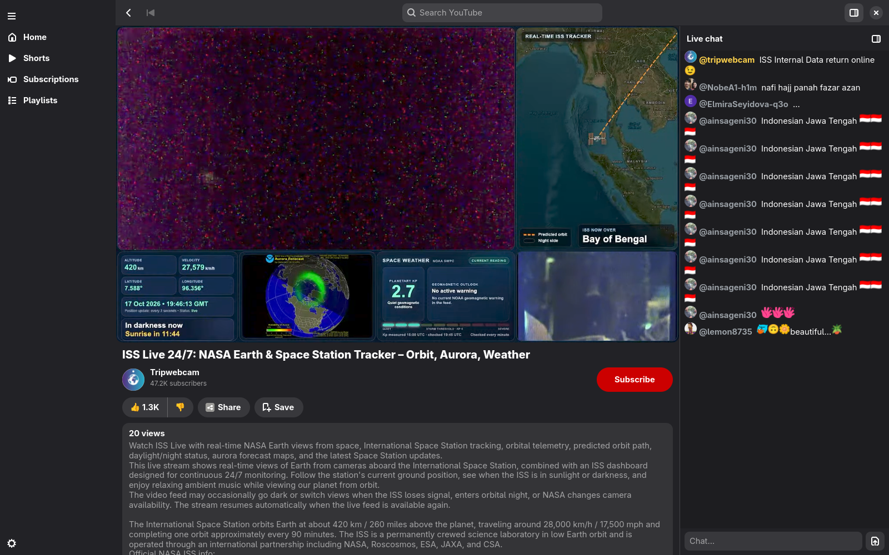
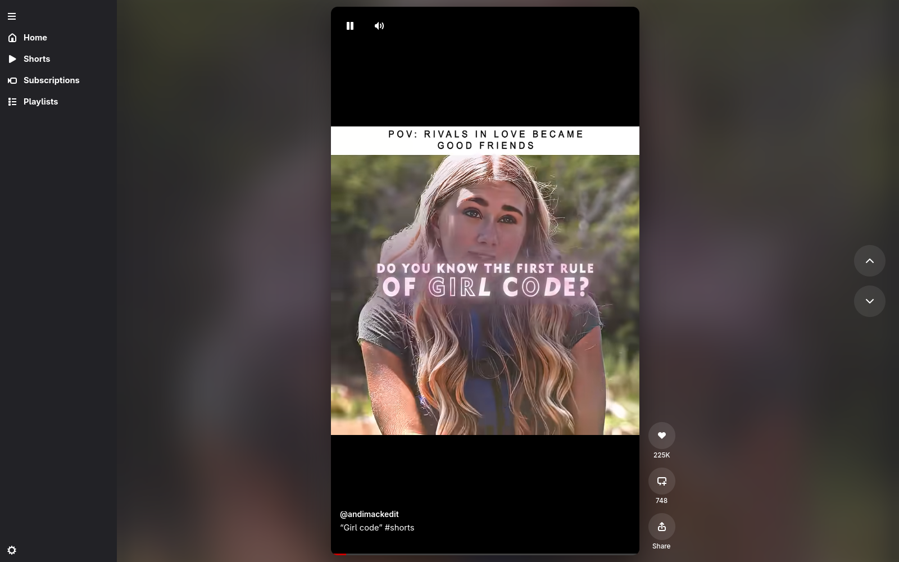

# moderntube

A YouTube client for the Linux desktop, written in Rust with GTK4 and libadwaita. It plays
VOD, live streams and Shorts over YouTube's own streaming protocol (SABR), through
[innertube-rs](https://github.com/moderntube/innertube-rs), and decodes with
GStreamer, using VA-API hardware decoding where it is available.

## Screenshots






## Features

- Home and Subscriptions feeds, search with suggestions, channel pages (Videos, Shorts,
  Live) and playlists.
- VOD and live playback with seeking, live DVR seeks and a jump back to the live edge,
  automatic or manual quality, and pitch-preserving playback speed.
- Live chat (read and post; docked, overlay or floating) and comments (read, post,
  like).
- Shorts, with the next Short preloaded.
- Hover previews on cards, a corner miniplayer, a watch queue, captions and storyboard
  thumbnails on the seek bar.
- Sign-in through an embedded browser window, with the session kept in the system
  keyring. Likes, subscriptions, Watch Later and watch history work when signed in.
- SponsorBlock segment skipping, MPRIS media keys, resume positions, light, dark and OLED
  themes with an accent colour.
- Optional "Catch me up" summaries of a live stream and questions over a video's
  transcript, through speech-to-text and chat endpoints you configure. Off by default.

## Status

In daily use, but young. Expect rough edges, and expect breakage when YouTube changes its
web client. Bug reports are welcome.

## Build

You need Rust 1.95 or later, a C compiler, and the development files for GTK 4.16 or
later, libadwaita 1.5 or later, GStreamer 1.18 or later (core and base plugins) and
WebKitGTK 6.0. At runtime you also need these GStreamer plugins:

- base: `appsrc`, `appsink`, `parsebin`, `decodebin3`, `audioconvert`, `audioresample`
- good: `qtdemux`, `matroskademux`, `pulsesink`
- bad: the `va` plugin, for hardware decoding
- `gtk4paintablesink`, from gst-plugins-rs
- libav, for software decoding when VA-API does not cover a codec

**Alpine:**

```sh
apk add build-base gtk4.0-dev libadwaita-dev webkit2gtk-6.0-dev \
    gstreamer-dev gst-plugins-base-dev gst-plugins-good gst-plugins-bad \
    gst-plugins-rs-gtk4 gst-libav
```

**Other distributions:** install the same components under your distribution's names.
GTK, GStreamer and WebKitGTK are linked dynamically. On musl, `.cargo/config.toml` turns
off the static C runtime for that reason.

Then:

```sh
cargo build --release
./target/release/moderntube
```

To install it for your user, with a launcher entry:

```sh
cargo install --path .
install -Dm644 data/io.github.moderntube.ModernTube.desktop -t ~/.local/share/applications
install -Dm644 data/io.github.moderntube.ModernTube.metainfo.xml -t ~/.local/share/metainfo
```

Sign-in stores its cookie through the Secret Service API (GNOME Keyring, KeePassXC and
others). Without a keyring it falls back to a file readable only by you.

## Usage

- **Sign in** from the account button in the header. Browsing and playback work without
  an account.
- **Preferences:** Ctrl+, opens them. Settings are stored in
  `$XDG_CONFIG_HOME/moderntube/settings.toml`.
- **Keys** on the player: Space play and pause, Left and Right seek 5 s (Right jumps to
  the edge on a live stream), Up and Down volume, `c` captions, `m` mute, Esc leaves fullscreen.
- **Logs** go to stderr. When stderr is not a terminal they also go to
  `$XDG_STATE_HOME/moderntube/moderntube.log`. Set `RUST_LOG` to change the level.
- **Test hooks:** `moderntube --help` lists command-line options that open a video, seek
  or switch quality at set times, for scripted runs.

## Documentation

- [`DESIGN.md`](DESIGN.md): architecture.
- [`AGENTS.md`](AGENTS.md): rules for contributors and coding agents.

## License

MIT, see [`LICENSE`](LICENSE). The WSOLA time stretch is ported from Chromium
(BSD-3-Clause); its notice is in [`LICENSE-chromium`](LICENSE-chromium).

## Disclaimer

This is an unofficial client. It is not affiliated with, endorsed by or supported by
YouTube or Google. YouTube is a trademark of Google LLC. Use it in line with the terms that
apply to you.
